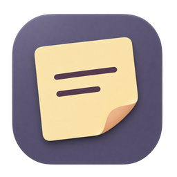

<p align="center">
  
</p>
<h1 align="center">Sticker</h1>
<p align="center">Grouped desktop stickies you can bring up with a keyboard shortcut.</p>
<p align="center">
  <strong>English</strong> · <a href="README.zh-CN.md">简体中文</a> · <a href="https://github.com/simplife-tech/Sticker/releases/latest">Download for macOS</a>
</p>


Sticker is a macOS menu bar app for keeping a checklist, reference image, or small interactive tool within reach. Show your stickers when you need them and hide them when you're done.

## Install

1. Download the macOS ZIP from [GitHub Releases](https://github.com/simplife-tech/Sticker/releases/latest).
2. Unzip it, move `Sticker.app` to **Applications**, and open it. Look for the Sticker icon in the menu bar.

The GitHub build supports macOS 14 or later on Apple silicon and Intel Macs. It uses ad-hoc signing and is not Apple-notarized, so macOS may show a warning when you first open it. Global shortcuts do not require Accessibility permission.

## Quick start

| Shortcut | Action |
| --- | --- |
| `⌥N` | Open the composer. Type or paste an image, then press `⌘Return` to create a sticker. |
| `⌥Tab` | Show or hide your stickers. |
| `⌥↑` / `⌥↓` | Cycle through groups while stickers are visible and you aren't editing a Sticker text field. |

Double-click a text sticker to edit it. Hover to reveal controls for copying, appearance, resizing, and folding. Click a folded sticker to expand it. Use the group picker at the top of the screen to switch groups, or open **Manage Stickers** from the menu bar to organize them.

## Plugins

Open **Manage Plugins** from the menu bar and click **+**. Import a local plugin folder or paste a GitHub folder link. Then press `⌥N` and choose the plugin from the sticker type picker.

- **Quick QR** turns a URL template such as `https://example.com/{id}` into a QR code. Change the parameter on the sticker to update the code, or click the generated link to copy it. [Plugin folder](examples/template-qr) · [GitHub import link](https://github.com/simplife-tech/Sticker/tree/main/examples/template-qr)
- **Clipboard History** is a preview plugin. After you enable recording, it keeps the last 50 plain-text entries in memory for the current session. Search, copy, pause, or clear the history from the sticker. [Plugin folder](examples/clipboard-history)

## Development

Open `Sticker.xcodeproj` in Xcode, select the **Sticker** scheme and **My Mac**, and click **Run**. From the repository root, you can also run:

```sh
xcodebuild -project Sticker.xcodeproj -scheme Sticker -configuration Debug build
```

Plugins use HTML and JavaScript and run in a WebView. See the [plugin guide](docs/plugins.md) for the folder format, host API, and localization.

## License

Sticker is available under the [MIT License](LICENSE). Quick QR bundles [QR Code Generator for JavaScript](examples/template-qr/LICENSE.qrcode-generator) under its own MIT notice.
