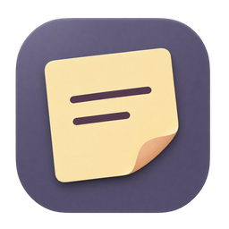

<p align="center">
  
</p>
<h1 align="center">Sticker</h1>
<p align="center">用快捷键随时调出分组贴纸的 macOS 菜单栏应用。</p>
<p align="center">
  <a href="README.md">English</a> · <strong>简体中文</strong> · <a href="https://github.com/simplife-tech/Sticker/releases/latest">下载 macOS 版</a>
</p>


把检查清单、参考截图和小工具放在手边。需要时叫出来，用完就收起来。

## 安装

1. 从 [GitHub Releases](https://github.com/simplife-tech/Sticker/releases/latest) 下载 macOS ZIP。
2. 解压后把 `Sticker.app` 拖到「应用程序」，打开后在菜单栏找到 Sticker 图标。

GitHub 安装包支持 macOS 14 及以上，同时支持 Apple 芯片和 Intel Mac。安装包使用 ad-hoc 签名，未经 Apple 公证，首次打开时系统可能会提示。全局快捷键无需辅助功能权限。

## 快速上手

| 快捷键 | 操作 |
| --- | --- |
| `⌥N` | 打开新建面板。输入文字或粘贴图片，按 `⌘Return` 创建。 |
| `⌥Tab` | 显示或隐藏贴纸。 |
| `⌥↑` / `⌥↓` | 贴纸显示且未在 Sticker 输入框内编辑时，循环切组。 |

双击文字贴纸即可编辑。鼠标悬停时会显示复制、外观、缩放和折叠控件。已经折叠的贴纸点一下就能展开。可以通过屏幕顶部的组名按钮切组，也可以从菜单栏打开「管理贴纸」来整理分组。

## 插件

从菜单栏打开「插件管理」，点击 **＋**，可以导入本地插件文件夹，也可以粘贴 GitHub 目录链接。安装后按 `⌥N`，从贴纸类型选择器里选中插件。

- **快速二维码**：填写 `https://example.com/{id}` 这样的地址模板，在贴纸上修改参数即可更新二维码，点击生成的链接可以复制。[插件目录](examples/template-qr) · [GitHub 导入链接](https://github.com/simplife-tech/Sticker/tree/main/examples/template-qr)
- **剪贴板历史**：试用插件。开启记录后，仅在本次运行的内存中保留最近 50 条纯文本，可在贴纸中搜索、复制、暂停或清空。[插件目录](examples/clipboard-history)

## 从源码构建

用 Xcode 打开 `Sticker.xcodeproj`，选择 **Sticker** scheme 和 **My Mac** 后运行。也可以在仓库根目录执行：

```sh
xcodebuild -project Sticker.xcodeproj -scheme Sticker -configuration Debug build
```

插件使用 HTML 和 JavaScript，在 WebView 中运行。插件目录结构、宿主接口和语言配置见[插件开发说明](docs/plugins.md)。

## 许可证

Sticker 采用 [MIT 许可证](LICENSE)。快速二维码插件采用的 [QR Code Generator for JavaScript](examples/template-qr/LICENSE.qrcode-generator) 保留其原有的 MIT 许可和版权声明。
